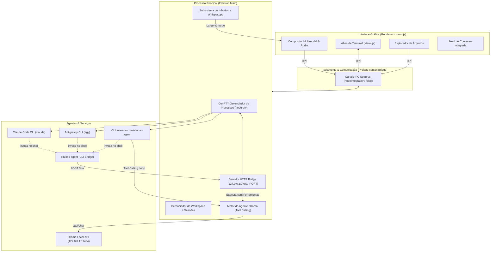

<div align="center">

# ⚡ CommandDeck Terminal

**O Terminal Desktop Colaborativo para Claude Code, Google Antigravity e Modelos Locais (Ollama)**

*Execute os CLIs oficiais de inteligência artificial lado a lado em abas interativas reais (ConPTY), integre modelos locais (Ollama) com execução autônoma de ferramentas, permita que conversem e debatam de forma autônoma entre si, dite comandos com Whisper neural 100% local e componha prompts multimodais.*

[](./LICENSE)
[](https://microsoft.com/windows)
[](https://www.electronjs.org/)
[](https://xtermjs.org/)
[-green.svg)](https://huggingface.co/ggerganov/whisper.cpp)
[](./bin/README.md)

</div>

> **Versão nativa em Rust (winit):** em desenvolvimento na pasta [`rust/`](rust/README.md), com as mesmas funções e o mesmo visual, sem Electron/Node.

---

## 💡 O Que é o CommandDeck?

No desenvolvimento moderno orientado a agentes, desenvolvedores frequentemente utilizam o **Claude Code** (`claude`) para raciocínio analítico e refatoração, o **Google Antigravity** (`agy`) para pesquisa e automação profunda de código, e modelos locais do **Ollama** (`qwen3.5:9b`, `qwen2.5-coder`, `llama3`) para privacidade total e execução offline. No entanto, esses agentes operavam isolados em janelas separadas de prompt, forçando o desenvolvedor a agir como "copia-e-cola humano" entre eles.

O **CommandDeck Terminal** unifica esses ecossistemas em uma aplicação desktop nativa construída com Electron, xterm.js e ConPTY. Mais do que apenas colocar terminais lado a lado, o CommandDeck equipa todos os agentes com um **protocolo de comunicação inter-agente nativo** (`ask-agent`), um **motor autônomo de ferramentas para modelos locais** e recursos para realizar **debates multirrodadas automatizados** com acompanhamento em tempo real.

---

## 🌟 Principais Recursos

### 🖥️ Terminais Interativos ConPTY Reais
- Sessões completas via Windows Pseudo Console (`node-pty` + `xterm.js`) para **Claude Code**, **Antigravity**, **Ollama** e **PowerShell**.
- Suporte total a cores ANSI de 24-bit, caracteres interativos de teclado, cursores e redimensionamento fluido com debounce de 60 ms.
- Gerenciamento intuitivo por abas com truncamento inteligente de títulos (`Ctrl+T` para nova aba, `Ctrl+Tab` para alternar).
- **Persistência de Sessão:** Suas abas abertas e a aba ativa são salvas automaticamente e restauradas ao reabrir a aplicação.
- **Tela de Início Rápido (Empty State):** Ao fechar todas as abas, um card interativo permite reabrir qualquer agente ou PowerShell com um clique.

### 🦙 Motor de Agente Autônomo Ollama (Modelos Locais com Ferramentas)
- Conexão nativa com a API local do Ollama (`127.0.0.1:11434/api/chat`) utilizando protocolo de Function Calling.
- Ferramentas nativas com sandbox estrito no workspace (`resolveWorkspacePath`):
  - `read_file`: leitura de arquivos com truncamento seguro;
  - `write_file`: criação e sobrescrita de arquivos e pastas pai;
  - `edit_file`: edição cirúrgica de trechos de código;
  - `list_directory`: listagem de arquivos com filtro de ruídos;
  - `run_command`: execução de comandos PowerShell dentro do projeto;
  - `delete_file`: exclusão controlada de arquivos.
- **Suporte Multimodal Local:** Anexos visuais (capturas de tela, imagens) são convertidos em base64 e despachados para modelos com capacidade de visão (`qwen3.5:9b`).
- **CLI Interativo (`bin/ollama-agent`):** Terminal REPL dedicado com saída colorida em tempo real, memória de sessão e comandos rápidos `/models` e `/switch <modelo>`.
- **Detecção Instantânea:** Leitura imediata de manifests do disco em ~1ms combinada com sincronização assíncrona da API HTTP (TTL de 15s).

### 🤖 Colaboração Autônoma Agente ↔ Agente (`ask-agent`)
- Utilitário de linha de comando nativo (`ask-agent <agente> "mensagem"`) disponível no `PATH` de cada terminal.
- Suporta Claude, Antigravity e modelos Ollama (`ask-agent ollama "mensagem"` ou `ask-agent qwen3.5:9b "mensagem"`).
- Limpeza automática de tags de raciocínio de LLMs (`<think>...</think>`) e formatação ANSI para respostas puras e legíveis.
- Fila de exclusão mútua assíncrona (mutex) por par de agentes, evitando colisões de estado.
- Memória contextual preservada por par entre chamadas consecutivas e proteção estrita contra recursão infinita (`MAX_DEPTH = 2`).
- Protocolo de colaboração contínua: agentes iteram de ponta a ponta sem interrupções desnecessárias ao usuário, que acompanha todo o feed na interface.

### 🏛️ Mesas de Orquestração e Debates Automatizados
- Conduza debates estruturados em $N$ rodadas entre quaisquer agentes (Claude ↔ Antigravity, Claude ↔ Ollama, Antigravity ↔ Ollama ou debates locais).
- Suporte a envio de anexos multimodais nas mesas de discussão.
- Seletor de alvos estruturado com grupos (`Destinatários Diretos` vs `Mesas de Orquestração`).
- Acompanhamento do diálogo em tempo real com stream de eventos na área "Conversa integrada".
- Síntese executiva final consolidada automaticamente pelo agente moderador ao término das rodadas.

### 🎙️ Transcrição de Voz 100% Local (Whisper.cpp) com Descarte Imediato
- Captura de áudio pelo microfone com normalização para WAV PCM 16 kHz Mono via Web Audio API.
- Inferência neural local via **`whisper.cpp`** utilizando o modelo **`large-v3-turbo`** (~1,62 GB).
- **Detecção e Aceleração de Hardware em Cascata:**
  1. 🟢 **NVIDIA CUDA (12.4):** Aceleração máxima em placas GeForce/RTX.
  2. 🔴/🔵 **Vulkan API:** Suporte nativo a placas **AMD Radeon** e **Intel Arc / Iris Xe**.
  3. ⚪ **CPU AVX2:** Fallback multithread universal com OpenMP.
- **Privacidade Absoluta e Retenção Zero:** Nenhum dado sai do seu computador. O arquivo `.wav` de áudio é **excluído imediatamente do disco** no milissegundo em que o texto é transcrito.
- **Botão de Cancelamento de Gravação:** Botão integrado com ícone `×` ao lado do microfone para abortar instantaneamente falas incorretas sem processamento.
- **Normalização Fonética:** Prompt contextual customizado para garantir acurácia em termos técnicos ("Claude", "Antigravity", "Ollama", "Vulkan", "CLI", "ConPTY").

### 📎 Compositor Multimodal Avançado
- Anexação de arquivos via botão de clipe com cópia assíncrona não bloqueante.
- Suporte nativo a **Arrastar e Soltar** (Drag & Drop) com overlay visual na interface.
- **Colagem Direta da Área de Transferência (`Ctrl+V`):** Cole capturas de tela diretamente no compositor.
- Retenção inteligente limitada às 5 últimas sessões, com purga automática de arquivos legados.

### 📂 Explorador de Arquivos Integrado
- Painel lateral retrátil (`Ctrl+B`) exibindo a árvore de diretórios do workspace em tempo real com monitoramento inteligente (`fs.watch` com debounce e filtros).
- Badges visuais coloridos por extensão de arquivo (`.js`, `.ts`, `.py`, `.md`, `.json`, etc.).
- Debounce anti-duplicação de cliques no mouse:
  - **1 clique:** Insere `@caminho/do/arquivo` diretamente na caixa de composição.
  - **2 cliques (Duplo clique):** Abre o arquivo diretamente no editor padrão do sistema operacional.

---

## ⚡ Início Rápido

### Pré-requisitos
Certifique-se de ter os seguintes componentes instalados:
1. **Windows 10 ou 11 (64-bit)**
2. **Node.js** (v18.x ou superior) & **Git**
3. Os CLIs oficiais instalados e autenticados:
   - **Claude Code:**
     ```powershell
     npm install -g @anthropic-ai/claude-code
     claude   # execute uma vez para realizar a autenticação
     ```
   - **Antigravity CLI:**
     ```powershell
     irm https://antigravity.google/cli/install.ps1 | iex
     agy login
     ```
   - **Ollama (Opcional — para modelos 100% locais):**
     Baixe e instale em [ollama.com](https://ollama.com/download), em seguida baixe o modelo desejado:
     ```powershell
     ollama pull qwen3.5:9b
     ```

### Instalação e Execução

```powershell
# 1. Clone o repositório
git clone https://github.com/pattrickn0/CommandDeck-Terminal.git
cd CommandDeck-Terminal

# 2. Instale as dependências
npm install

# 3. Inicie o CommandDeck Terminal
npm start
```

### 🚀 Gerando o Atalho Direto no Windows
Para iniciar o CommandDeck em segundo plano com um clique, sem deixar janelas pretas de console abertas, gere o atalho oficial para a pasta do projeto e para a sua Área de Trabalho:

```powershell
npm run shortcut
```

Isso gerará o atalho `CommandDeck.lnk` apontando dinamicamente para o executável do Electron no seu sistema.

---

## 🏗️ Arquitetura do Sistema



---

## ⌨️ Tabela de Atalhos de Teclado

| Atalho | Ação | Descrição |
| :--- | :--- | :--- |
| `Ctrl + T` | **Nova Aba** | Abre uma nova sessão interativa de terminal. |
| `Ctrl + Tab` | **Alternar Aba** | Alterna ciclicamente entre as abas abertas. |
| `Ctrl + B` | **Alternar Sidebar** | Recolhe ou expande o explorador de arquivos. |
| `Ctrl + V` | **Colar Multimodal** | Cola texto no compositor ou anexa prints da área de transferência. |
| `Enter` | **Enviar Prompt** | Envia o comando para o terminal ativo ou orquestração. |
| `Shift + Enter`| **Quebra de Linha** | Insere nova linha no campo de texto sem enviar. |
| `Clique Único` | **Inserir @Caminho** | Clica em um arquivo no explorador para referenciá-lo no prompt. |
| `Duplo Clique` | **Abrir no SO** | Abre o arquivo selecionado no editor de código padrão do sistema. |

---

## 📚 Documentação Técnica Completa

Para aprofundamento em cada subsistema de engenharia, consulte os manuais dedicados na pasta [`documentation/`](./documentation/README.md):

1. **[Guia de Instalação e Solução de Problemas (`documentation/setup-and-troubleshooting.md`)](./documentation/setup-and-troubleshooting.md)** — Pré-requisitos, login nos CLIs oficiais, compilação Vulkan e troubleshooting detalhado.
2. **[Arquitetura Técnica do Sistema (`documentation/architecture.md`)](./documentation/architecture.md)** — Estrutura de processos (Main, Preload, Renderer), ConPTY, motor Ollama com tool-calling e segurança.
3. **[Protocolo de Comunicação Agente ↔ Agente (`documentation/agents-protocol.md`)](./documentation/agents-protocol.md)** — Mecânica do `ask-agent`, bridge HTTP, sandbox de ferramentas do Ollama e debates multirrodadas.
4. **[Subsistema de Transcrição Whisper Local (`documentation/whisper-transcription.md`)](./documentation/whisper-transcription.md)** — Engenharia Web Audio API, inferência neural, GPUs suportadas e descarte imediato.
5. **[Manual do Usuário (`documentation/user-manual.md`)](./documentation/user-manual.md)** — Guia operacional detalhado, terminal interativo do Ollama, compositor multimodal e fluxos de uso.
6. **[Limitações Técnicas e Roadmap (`documentation/limitations-and-roadmap.md`)](./documentation/limitations-and-roadmap.md)** — Auditoria técnica completa, matriz de riscos e plano de evolução.

---

## 📁 Estrutura do Repositório

```
commanddeck/
├── bin/                       # Utilitários CLI de colaboração e agentes
│   ├── ask-agent              # Wrapper shell POSIX para consulta entre agentes
│   ├── ask-agent.cmd          # Wrapper batch para Windows CMD/PowerShell (UTF-8)
│   ├── ask-agent.js           # Mecanismo HTTP bridge
│   ├── ollama-agent           # Wrapper shell POSIX para REPL do agente Ollama
│   ├── ollama-agent.cmd       # Wrapper batch para Windows do agente Ollama (UTF-8)
│   ├── ollama-agent.js        # Terminal REPL interativo com ferramentas e cores xterm
│   └── README.md              # Documentação dos binários CLI
├── dados/                     # Diretório de execução temporária (ignorado no Git)
│   ├── anexos/                # Armazenamento efêmero de prints e anexos (5 sessões)
│   └── README.md              # Política de dados e privacidade
├── documentation/             # Manuais e especificações de engenharia detalhadas
│   ├── agents-protocol.md
│   ├── architecture.md
│   ├── limitations-and-roadmap.md
│   ├── README.md
│   ├── setup-and-troubleshooting.md
│   ├── user-manual.md
│   └── whisper-transcription.md
├── renderer/                  # Interface gráfica (HTML5, CSS3, xterm.js)
│   ├── index.html
│   ├── renderer.js
│   └── styles.css
├── scripts/                   # Scripts auxiliares de automação e compilação
│   ├── build-vulkan.ps1       # Compilador whisper.cpp Vulkan para AMD/Intel
│   └── create-shortcut.ps1    # Gerador de atalhos silenciosos para Windows
├── whisper/                   # Motores de inferência e pesos neurais de fala
│   ├── bin-cpu/               # Engine de fallback universal para CPU
│   ├── bin-vulkan/            # Engine compilada para GPUs Vulkan (AMD/Intel)
│   ├── models/                # ggml-large-v3-turbo.bin (download automático)
│   └── README.md              # Documentação do subsistema de voz
├── workspace/                 # Sandbox padrão de trabalho isolado para os agentes
│   ├── AGENTS.md              # Instruções de colaboração para os CLIs
│   └── README.md              # Documentação do ambiente de trabalho
├── AGENTS.md                  # Regras globais de colaboração lidas pelos agentes
├── CONTRIBUTING.md            # Guia de contribuição e convenções de código
├── LICENSE                    # Licença MIT
├── main.js                    # Processo principal do Electron, ConPTY e Bridge
├── ollamaAgent.js             # Motor autônomo do Ollama com Function Calling & Sandbox
├── package.json               # Configuração do projeto e dependências
├── preload.js                 # Bridge IPC isolado com contextIsolation
└── README.md                  # Este documento principal
```

---

## 🔒 Privacidade e Segurança

- **Zero Telemetria de Voz:** Nenhum áudio ou transcrição é transmitido para provedores externos. Toda a inferência do Whisper roda no seu hardware local.
- **Descarte Imediato:** Áudios temporários são excluídos do disco assim que o texto é obtido.
- **Isolamento de Processos:** Os terminais ConPTY operam isolados com segurança reforçada no Electron (`nodeIntegration: false`, `contextIsolation: true`).
- **Autenticação Local:** O servidor bridge interno escuta estritamente na interface de loopback (`127.0.0.1`) e valida cada requisição com tokens de alta entropia.

---

## 🤝 Contribuições

Contribuições são muito bem-vindas! Se você deseja reportar um bug, sugerir novos recursos ou enviar melhorias, consulte o nosso [Guia de Contribuição (`CONTRIBUTING.md`)](./CONTRIBUTING.md).

---

## 📄 Licença

Este projeto é distribuído sob os termos da licença [MIT](./LICENSE).
