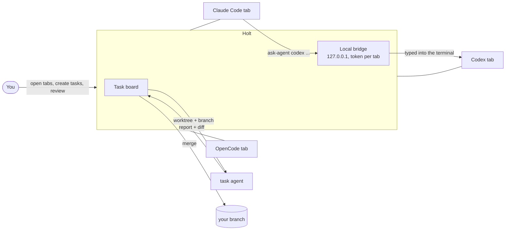

<p align="center">
  
</p>

<h1 align="center">Holt</h1>

<p align="center">
  <b>A den for your coding agents.</b><br>
  Claude Code, Codex, Antigravity and OpenCode in one native window — talking to each other,<br>
  working on isolated branches, and handing you diffs instead of chaos.
</p>

<p align="center">
  <a href="https://github.com/pattrickn0/Holt/actions/workflows/ci.yml"></a>
  
  
  <a href="LICENSE"></a>
</p>

<p align="center">
  
</p>

---

## The problem

Every agent CLI is good on its own. Use three at once and you get a pile of terminals: you copy text from one to
another, lose track of who is doing what, and pray two of them don't edit the same file. Your quota runs out on the
one you always reach for while the others sit idle.

**Holt is the den where they work together.** One window, every agent in a real terminal tab, a way for them to call
each other, and a task board where big work happens on its own branch and comes back to you as a reviewable diff.

## What makes it different

|  |  |
| :-- | :-- |
| 🗣️ **Agents talk to each other** | Inside any tab, an agent runs `ask-agent codex "review this function"`. The question is typed into Codex's terminal and the answer comes back to whoever asked. Every exchange shows up in the Integrated Chat. |
| 🌿 **Every task on its own branch** | A task gets a git worktree and a branch. The agent works there, delivers a report, and you review the diff and the timeline. Discarding a bad attempt costs nothing. |
| 🔀 **Conflicts don't land on you** | A delivery that conflicts with its base is refused until the agent merges the base in. If the base moves after that, Merge sends the conflict back to the agent and finishes on its own when the agent delivers again. |
| ⚖️ **The right model for the job** | Say how big the work is (simple, medium, complex). Holt picks among the models that can handle it — public benchmarks plus your own task history — and, among those, the one with the most quota left. |
| 🧠 **Memory that lives in the repo** | Pitfalls, decisions and conventions are markdown files versioned with the code. Each agent gets the slice that matters for the files it is about to touch. |
| 👀 **Nothing invisible** | Every agent has a real terminal you can type into. No hidden subagents, no background magic you can't inspect. |

## How it works



1. **Open a project** (any folder with code). Each project has its own agents; switching projects keeps the others running.
2. **Open agents as tabs.** Several instances of the same CLI can coexist with roles and models: `claude`, `claude@dev` on Sonnet, `claude@review` on Opus.
3. **Let them collaborate.** Every tab receives Holt's instructions through the CLI's own channel, so agents already know how to call each other, report to a boss and open tasks.
4. **Send big work to the board.** Draft → queued → in progress → in review → awaiting validation → done. Return it with feedback, reject it, or discard it at any point.

## Features

<details open>
<summary><b>Agents</b></summary>

- Real terminal tabs for each agent (ConPTY on Windows, a PTY on Linux), restored — conversation included — when the app reopens.
- Multiple instances per agent with role and name (`claude@dev@ana`), each with its own model shown next to the name.
- Teams: drag one agent onto another in the sidebar to make it the boss; subordinates report with `ask-agent --boss`.
- Plan usage in the title bar: each agent's 5-hour and weekly limits, with a warning from 80%. An exhausted model gets no requests.
- No blocking prompts: project folders are registered as trusted in Claude Code, Codex and Antigravity, so a tab opened in the background never stalls on "Do you trust this folder?".
- Headless mode: with agent tabs turned off, `ask-agent` runs `claude -p`, `codex exec`, `opencode run`… instead.
</details>

<details open>
<summary><b>Task board</b></summary>

- Isolated worktree and branch per task, report, syntax-highlighted diff and the timeline of messages the agent exchanged.
- Scoped queue: a task that declares the paths it touches waits for any running task on the same paths and starts by itself.
- Mergeable on delivery; conflicts at merge time go back to the agent and merge automatically on redelivery (up to three tries before it asks you).
- "Waiting for your review" on the board and in the tray tooltip, so finished work never sits forgotten.
</details>

<details>
<summary><b>Workspace</b></summary>

- Three layouts: **Tabs**, **Split** (a window per agent type, in a grid) and **Highlight** (the active one large, the rest stacked).
- **Documents** mode: read and edit files with syntax highlighting and search, full-width diffs and reports (`Ctrl+Shift+D`).
- **Git**: changes, hunk staging, commit, branches, merge and rebase, conflicts, stash.
- **GitHub**: PRs with checks, issues, Actions and the log of the failed job — one click sends the failure to an agent.
- Attachments by button, drag and drop or `Ctrl+V` (images too).
- Optional **voice dictation** with local whisper.cpp (CUDA, Vulkan or CPU). Silent recordings are refused instead of being typed as made-up text.
- System tray: × keeps the agents working in the background; launching the app again brings the same window back.
- English by default, Portuguese (pt-BR) in Settings.
</details>

## Quick start

**1. Install at least one agent CLI.** Holt uses whatever it finds.

| CLI | Install |
| :-- | :-- |
| Claude Code | `npm install -g @anthropic-ai/claude-code` |
| Codex | `npm install -g @openai/codex` |
| Antigravity | Windows: `irm https://antigravity.google/cli/install.ps1 \| iex` · Linux: installer at https://antigravity.google |
| OpenCode | `npm install -g opencode-ai` (free models included; runs local models too) |

Aider, Goose, GitHub Copilot CLI, Amazon Q, Open Interpreter and a plain shell also open as tabs, with less integration.

**2. Build Holt** (Rust 1.89+ from [rustup.rs](https://rustup.rs)).

<details open>
<summary><b>Linux</b></summary>

```bash
# Ubuntu / Debian
sudo apt install build-essential pkg-config libasound2-dev libxkbcommon-dev
# Fedora
sudo dnf install gcc gcc-c++ make pkgconf-pkg-config alsa-lib-devel libxkbcommon-devel
# openSUSE
sudo zypper install gcc gcc-c++ make pkgconf-pkg-config alsa-devel libxkbcommon-devel

git clone https://github.com/pattrickn0/Holt.git && cd Holt
cargo build --workspace --release
```

The release build adds **Holt** to your app menu, icon included. Open it from there, or run `./target/release/holt`.

- Opening folders, links and file dialogs needs `xdg-utils` and `xdg-desktop-portal` with a backend (`-gtk` on GNOME/XFCE, `-kde` on KDE).
- No sound or microphone (drops ALSA): `cargo build -p holt --no-default-features --release`.
- Skip the menu entry with `HOLT_NO_DESKTOP_ENTRY=1`; remove it with `scripts/install-desktop.sh --uninstall`.
- Runs on X11 and Wayland (tested on Ubuntu and on GNOME/openSUSE Tumbleweed; Fedora in CI). Details in [memory/LINUX.md](memory/LINUX.md).
</details>

<details>
<summary><b>Windows</b></summary>

```powershell
git clone https://github.com/pattrickn0/Holt.git
cd Holt
cargo build --workspace --release
.\target\release\holt.exe
```
</details>

The build produces two executables that must stay in the same folder: `holt` (the app) and `ask-agent` (the command
agents use; Holt puts it on every tab's `PATH`). There is no installer yet: the app runs from where it was built.

**3. Go.** Click **Open folder…** to add a project, open an agent under **+ New agent**, and talk to it. Ask it to
bring in another agent — it knows how. For anything bigger, use **+ New task** on the board.

## `ask-agent` in 30 seconds

Agents use it on their own. You can too, from a plain terminal tab.

```bash
# Talk
ask-agent codex "Review parse_config in src/config.rs"
ask-agent --model sonnet claude@dev "Implement item 3"   # opens claude@dev on Sonnet if needed
ask-agent --reply 7 "Done: src/ is split"                # answer question #7
ask-agent --boss "Review finished"                       # report up

# Look around
ask-agent --list        # open agents and instances
ask-agent --team        # your boss and your crew
ask-agent --models      # models per agent, quota and capability

# Delegate
ask-agent --task new "Login screen" --level complex --scope src/ui --start --file brief.md
ask-agent --task list
ask-agent --task merge t3      # merge into the base; awaits validation
ask-agent --task validate t3   # done; worktree and branch cleaned up

# Remember
ask-agent --learn src/config.rs    # what the project learned about this file
ask-agent --outline src/config.rs  # signatures with line numbers
```

Full reference: [memory/OVERVIEW.md](memory/OVERVIEW.md#2-what-you-can-do).

## Shortcuts

| Shortcut | Action |
| :-- | :-- |
| `Ctrl+T` | new tab of the focused agent type |
| `Ctrl+Tab` / `Ctrl+Shift+Tab` | next / previous tab in the window |
| `Ctrl+Alt+arrows` | focus the neighboring window |
| `Ctrl+B` | show or hide the sidebar |
| `Ctrl+Shift+D` | switch the center between Agents and Documents |
| `Ctrl+Shift+M` | dictate into the visible tab |
| `Ctrl+S` / `Ctrl+F` | save / find in the open document |
| `Ctrl+/` | all shortcuts |

With a terminal focused, `Ctrl+B` goes to the program in it (handy in tmux); "App shortcuts above the terminal" in the
☰ menu flips that.

## Privacy and safety

- **No Holt server.** There isn't one. The CLIs talk to their own providers; quota is read from credentials they already keep on your machine.
- **Local bridge only.** Agent-to-agent traffic is HTTP on `127.0.0.1` with a token per tab, so one agent cannot pose as another. Text from another agent never reaches a terminal with control characters.
- **Guard rails.** Delegation depth is capped at 2, wait cycles are refused, and at most 8 tabs open on their own.
- **Audio is deleted** right after transcription. Attachments and long prompts are kept for the last 5 sessions only.
- **Trust is explicit.** Opening a folder as a project registers it as trusted in Claude Code (`~/.claude.json`) and Antigravity; your home folder and drive roots never are.
- **Where things live:** runtime data in `data/` next to the executable (or `HOLT_HOME`); settings in `~/.config/Holt/config.json` (Linux) or `%APPDATA%\Holt\config.json` (Windows).

## Under the hood

100% Rust: [winit](https://github.com/rust-windowing/winit) + [egui](https://github.com/emilk/egui) on OpenGL,
alacritty's terminal emulator, a backend crate (`holt-core`) with no UI, and the `ask-agent` CLI (`holt-cli`). The UI
never blocks: processes, network and transcription run on their own threads.

The project documents itself in [`memory/`](memory/OVERVIEW.md), versioned with the code — the same files the agents
read:

- [OVERVIEW.md](memory/OVERVIEW.md) — start here: how the app works and the map of the docs
- [ARCHITECTURE.md](memory/ARCHITECTURE.md) — crates, flows and the bridge's HTTP contract
- [MAINTENANCE.md](memory/MAINTENANCE.md) — build, test, recipes, and a hands-on intro to Rust
- [HOLT.md](memory/HOLT.md) — vision and direction
- [backlog.md](memory/backlog.md) · [history.md](memory/history.md) — what's next, what's done
- [learnings/](memory/learnings/README.md) — the traps and decisions the code doesn't show

## Contributing

See [CONTRIBUTING.md](CONTRIBUTING.md). Before a PR: `cargo fmt --all`,
`cargo clippy --workspace --all-targets -- -D warnings` and `cargo test --workspace` — CI runs all three on Windows,
Ubuntu and Fedora.

## Why "Holt"?

A *holt* is an otter's den: the place where the family lives, rests and works together. Otters are also among the few
animals that use tools. That's the idea — a den where agents with tools work as a team.

## License

[MIT](LICENSE)
