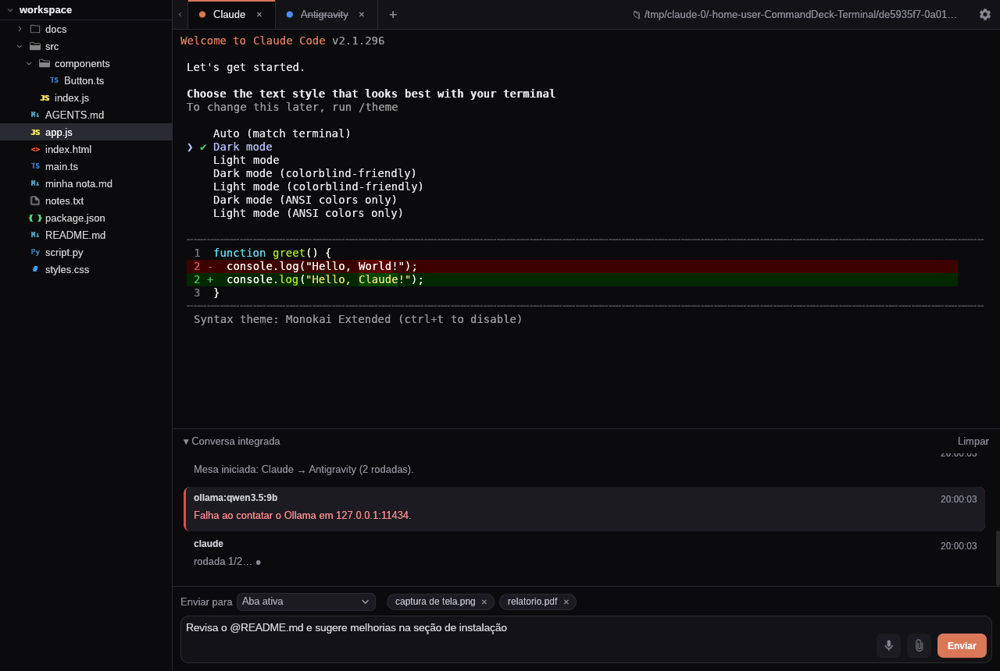

# ⚡ CommandDeck Terminal

Terminal desktop nativo (Rust + winit) que conecta agentes de IA: **Claude Code**, **Antigravity CLI**,
**modelos locais via Ollama** e outros CLIs. Os agentes conversam entre si (`ask-agent`), colaboram em
mesas de orquestração e trabalham na mesma pasta, enquanto você acompanha tudo na **Conversa integrada**.



## Funções

- Abas de terminal reais (ConPTY no Windows) para cada agente, com cores próprias, restauradas ao reabrir.
- **Conversa integrada**: perguntas e respostas entre agentes em tempo real.
- **Enviar para**: aba ativa, todos os agentes abertos ou **mesas** (vários agentes em rodadas, com síntese final).
- Explorador de arquivos do workspace: clique insere `@arquivo` na mensagem, duplo clique abre no sistema.
- Anexos por botão, arrastar e soltar ou colar imagem (Ctrl+V).
- Ditado por voz com **whisper.cpp** local (CUDA / Vulkan / CPU); o áudio é apagado logo após transcrever.
- Agente **Ollama** autônomo com ferramentas no workspace (ler/escrever/editar arquivos, rodar comandos).
- Som de notificação quando um agente termina.

Atalhos: `Ctrl+T` nova aba · `Ctrl+Tab` / `Ctrl+Shift+Tab` alternar · `Ctrl+B` barra lateral ·
`Ctrl+L` focar mensagem · `Enter` envia · `Shift+Enter` quebra linha.

## Compilar e rodar (Windows)

Pré-requisito: [Rust](https://rustup.rs) (stable).

```powershell
cargo build --workspace --release
.\target\release\commanddeck.exe
```

Os três executáveis (`commanddeck`, `ask-agent`, `ollama-agent`) precisam ficar **na mesma pasta**.
As pastas `dados/`, `workspace/` e `whisper/` são procuradas subindo a partir do executável
(ou defina `COMMANDDECK_HOME`). Configuração em `%APPDATA%\CommandDeck\config.json`.

CLIs suportados (instale os que quiser usar):
- Claude Code: `npm install -g @anthropic-ai/claude-code`
- Antigravity: `irm https://antigravity.google/cli/install.ps1 | iex`
- Ollama: https://ollama.com/download

## Comunicação entre agentes

Dentro de qualquer aba:

```bash
ask-agent antigravity "Revise a estrutura de pastas proposta"
ask-agent --list
cat relatorio.txt | ask-agent claude -
```

Detalhes do protocolo e da arquitetura em [ARCHITECTURE.md](ARCHITECTURE.md).

## Manutenção

Guia para quem vai manter o projeto (sozinho ou com agentes), incluindo uma introdução prática ao Rust:
**[docs/MANUTENCAO.md](docs/MANUTENCAO.md)**. Para contribuir: [CONTRIBUTING.md](CONTRIBUTING.md).

## Licença

MIT — veja [LICENSE](LICENSE).
