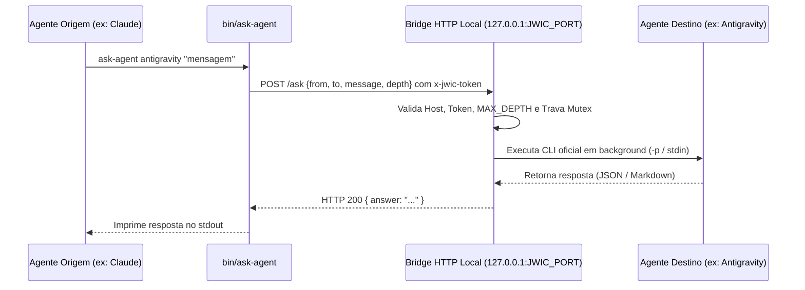

# 🛠️ Utilitário de Colaboração Inter-Agentes (`bin/ask-agent`)

O diretório `bin/` contém o executável utilitário **`ask-agent`**, responsável por intermediar a comunicação autônoma entre diferentes agentes de IA (Claude Code, Google Antigravity e Shell) executando dentro do **CommandDeck Terminal**.

---

## 🚀 Como Usar

O diretório `bin/` é injetado automaticamente na variável de ambiente `PATH` de cada terminal ConPTY aberto na aplicação. Tanto os agentes quanto você podem executar o comando diretamente no shell:

### 1. Consulta Direta
```bash
ask-agent claude "Você pode revisar esta função em TypeScript para identificar possíveis race conditions?"
```

```bash
ask-agent antigravity "Qual é o comando agy para listar regras personalizadas ativas no workspace?"
```

### 2. Entrada via Pipeline (Stdin)
Ideal para enviar blocos de código grandes, arquivos inteiros ou saídas de comandos:
```bash
git diff | ask-agent claude -
cat main.js | ask-agent antigravity "Analise a estrutura de tratamento de exceções deste arquivo:"
```

### 3. Listagem de Agentes Disponíveis
```bash
ask-agent --list
```
*Saída:*
```
claude
antigravity
```

---

## ⚙️ Arquitetura e Protocolo Interno



### Variáveis de Ambiente Injetadas pelo CommandDeck
Ao instanciar cada terminal, o processo principal do Electron injeta no ambiente local do PTY:

| Variável | Descrição |
| :--- | :--- |
| `JWIC_PORT` | Porta TCP efêmera do servidor HTTP interno (apenas `127.0.0.1`). |
| `JWIC_TOKEN` | Token criptográfico de autenticação exigido no cabeçalho `x-jwic-token`. |
| `JWIC_AGENT` | Identificador do agente emissor (`claude`, `antigravity` ou `shell`). |
| `JWIC_DEPTH` | Contador de profundidade de aninhamento de chamadas. |
| `JWIC_NODE` | Caminho do executável Node.js do próprio Electron (permite rodar sem Node global). |

### Mecanismos de Proteção e Governança
- **Prevenção de Recursão (`MAX_DEPTH`):** Bloqueia cascatas infinitas (limite padrão de profundidade = 2).
- **Auto-Chamada Bloqueada:** Um agente é terminantemente impedido de consultar a si mesmo.
- **Fila de Exclusão Mútua (Mutex):** Consultas concorrentes ao mesmo agente de destino são enfileiradas sequencialmente para não corromper o estado do CLI.
- **Preservação de Contexto por Par:** Conversas contínuas entre o mesmo par de agentes reutilizam o mesmo identificador de sessão (`sessionId`), garantindo coerência e memória entre turnos.

---

## 🦙 CLI Interativo do Agente Ollama (`bin/ollama-agent`)

O executável `ollama-agent` (com wrappers `ollama-agent.cmd` no Windows e `ollama-agent` em Unix) provê um console REPL interativo com ferramentas de workspace ativas para modelos locais do Ollama (como `qwen3.5:9b`).

### Uso Manual no Terminal
```bash
# Iniciar com o modelo padrão configurado:
ollama-agent

# Iniciar especificando um modelo específico do Ollama:
ollama-agent qwen3.5:9b
ollama-agent qwen2.5-coder:7b
```

### Recursos Ativos no REPL
- **Feedback Visual de Ferramentas:** Toda chamada de ferramenta (`read_file`, `write_file`, `edit_file`, `list_directory`, `run_command`, `delete_file`) é impressa com destaque colorido no terminal.
- **Memória de Sessão:** O histórico do diálogo é preservado entre mensagens sucessivas durante a execução do REPL.
- **Integração com Abas:** Instanciado automaticamente pelo CommandDeck ao abrir uma aba de terminal do Ollama.
