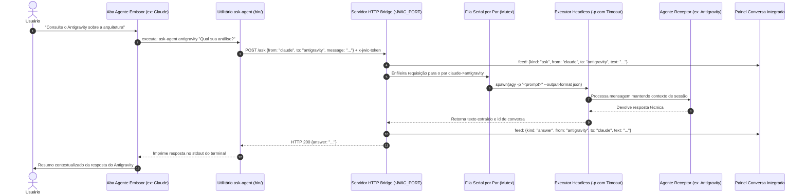

# Protocolo de Comunicação Agente ↔ Agente (CommandDeck Terminal)

Este documento especifica formalmente o protocolo de comunicação, contratos de dados, fluxo de autenticação e arquitetura de mensagens para a colaboração autônoma entre múltiplos agentes de IA no **CommandDeck Terminal**.

---

## 🛰️ Visão Geral do Protocolo

O ecossistema do CommandDeck permite que modelos e agentes operando em abas distintas conversem entre si autonomamente. Um agente pode pedir uma segunda opinião, solicitar que outro agente revise código, audite vulnerabilidades ou complemente análises técnicas.



---

## 🔑 Variáveis de Ambiente Injetadas

Ao iniciar qualquer processo de terminal interativo (`claude`, `antigravity` ou `powershell`), o CommandDeck prepara o ambiente injetando:

| Variável | Tipo | Descrição |
| :--- | :--- | :--- |
| `JWIC_PORT` | Inteiro | Porta TCP local efêmera alocada pelo servidor HTTP interno (ex.: `52730`). |
| `JWIC_TOKEN` | String (Hex) | Token de segurança aleatório de 128 bits gerado a cada inicialização da aplicação. |
| `JWIC_AGENT` | String | Identificador do agente rodando na aba atual (`claude`, `antigravity` ou `shell`). |
| `JWIC_DEPTH` | Inteiro | Nível de profundidade atual de chamadas recursivas (inicia em `0`). |
| `JWIC_NODE` | Caminho | Caminho absoluto para o executável Node.js do próprio Electron (`process.execPath`), dispensando a obrigatoriedade de Node.js instalado no sistema operacional do usuário. |

Além disso, a pasta `bin/` do CommandDeck é concatenada no início da variável `PATH`.

---

## 🛠️ O Utilitário CLI `ask-agent`

O utilitário está implementado em `bin/ask-agent.js` e possui wrappers para shell Unix/Bash (`bin/ask-agent`) e prompt do Windows (`bin/ask-agent.cmd`).

### 1. Sintaxe de Comando
```bash
# Sintaxe padrão passando mensagem via argumento:
ask-agent <agente> "mensagem para o agente"

# Leitura de mensagem longa via entrada padrão (stdin / pipe):
cat relatorio.txt | ask-agent claude -

# Listagem de agentes disponíveis no ambiente:
ask-agent --list

# Ajuda:
ask-agent --help
```

### 2. Tratamento de Erros e Códigos de Saída
- **Código `0` (Sucesso):** Resposta impressa diretamente no `stdout`.
- **Código `1` (Erro Operacional):** Erro retornado pela API ou falha na execução do agente (mensagem de erro em `stderr`).
- **Código `2` (Erro de Argumentos):** Parâmetros inválidos, mensagem vazia ou execução fora do ambiente CommandDeck.

---

## 🌐 Especificação da API HTTP do Bridge

O servidor HTTP local escuta estritamente em `127.0.0.1` e valida autenticação em todas as requisições.

### Cabeçalhos Obrigatórios
```http
x-jwic-token: <valor de BRIDGE_TOKEN>
content-type: application/json
```

---

### Endpoint 1: Listagem de Agentes
- **Método:** `GET`
- **Rota:** `/agents`
- **Descrição:** Retorna os identificadores dos agentes atualmente instalados e disponíveis para colaboração.
- **Resposta de Sucesso (HTTP 200):**
  ```json
  {
    "agents": ["claude", "antigravity"]
  }
  ```

---

### Endpoint 2: Consulta entre Agentes com Fila Serial
- **Método:** `POST`
- **Rota:** `/ask`
- **Descrição:** Envia uma mensagem para o agente receptor em modo headless e retorna a resposta gerada. A execução para o mesmo par de agentes é serializada em fila assíncrona para evitar condições de corrida no histórico da sessão.

#### Payload da Requisição:
```json
{
  "from": "claude",
  "to": "antigravity",
  "message": "Você pode avaliar se a estrutura de pastas proposta segue boas práticas?",
  "depth": 0
}
```

#### Regras de Validação e Códigos de Retorno:
1. **HTTP 403 Forbidden:** Cabeçalho `x-jwic-token` incorreto ou cabeçalho `Host` divergente de `127.0.0.1:${port}`.
2. **HTTP 400 Bad Request:**
   - JSON malformado;
   - Agente de destino desconhecido ou não instalado;
   - Auto-chamada (`to === from`);
   - Profundidade máxima atingida (`depth >= MAX_DEPTH`, onde `MAX_DEPTH = 2`).
3. **HTTP 200 OK:** Execução bem-sucedida.
   ```json
   {
     "answer": "Avaliei a estrutura e considero adequada para o escopo do projeto..."
   }
   ```
4. **HTTP 500 Internal Server Error:** O processo headless do agente retornou erro durante o processamento ou atingiu o tempo limite de 10 minutos.

---

## 🔄 Gerenciamento de Histórico por Par (`sessions`)

Para que as conversas entre agentes não sejam puramente transacionais e sem memória, o CommandDeck mantém um mapa em memória (`sessions`) associando pares de comunicação:

- **Chave de Sessão:** Formato `<emissor>-><receptor>` (ex.: `claude->antigravity`).
- **Claude:**
  - Na primeira interação, gera um identificador UUID e inicia a sessão com `--session-id <uuid>`.
  - Nas mensagens seguintes, utiliza `--resume <uuid>`.
- **Antigravity:**
  - Recebe `--conversation <id>` obtido do campo `conversation_id` da resposta anterior.
- **Mecanismo de Auto-Recuperação:** Caso o CLI retorne erro indicando que a sessão anterior expirou ou tornou-se inválida, o CommandDeck descarta a sessão corrompida e dispara uma nova tentativa limpa automaticamente.

---

## 👥 Mesas de Orquestração (Multi-Agent Round Tables)

O modo de Mesa Colaborativa permite que múltiplos agentes trabalhem juntos para resolver um problema complexo por meio de debates estruturados em rodadas ($N$ rodadas):

1. **Definição da Tarefa:** O usuário especifica o enunciado e define o número de rodadas (de 1 a 6).
2. **Histórico Cumulativo:** A cada turno, o prompt injetado no agente contém todo o histórico transcrito das rodadas anteriores.
3. **Prompt Estruturado por Rodada:**
   - Identifica os outros agentes participantes da mesa;
   - Exibe a tarefa original e os arquivos anexados;
   - Exibe a conversa acumulada até o momento;
   - Instrui o agente a ser objetivo, criticar construtivamente e construir sobre as ideias anteriores.
4. **Fechamento e Síntese Final:** No último turno da última rodada, o último agente a falar recebe a instrução especial: *"Como último a falar, feche com uma síntese final da mesa."*
5. **Controle de Abort:** O botão `Parar` no compositor aciona o evento `table:stop`, setando a flag `tableAbort = true` e encerrando graciosamente os processos de trabalho.

---

## 🦙 Agente Local Autônomo Ollama (`ollamaAgent.js`)

Ao contrário de execuções convencionais de LLM em modo texto simples, o CommandDeck implementa um **motor de agente autônomo com suporte a Function Calling / Tool Use nativo** para modelos locais (como `qwen3.5:9b`, `qwen2.5-coder`, etc.) via API HTTP do Ollama (`127.0.0.1:11434/api/chat`).

### 1. Ferramentas Integradas do Workspace (`WORKSPACE_TOOLS`)
O agente possui autorização completa para ler, modificar e operar dentro do diretório do workspace configurado:

| Ferramenta | Parâmetros | Descrição |
| :--- | :--- | :--- |
| `read_file` | `path` (string) | Lê o conteúdo textual de qualquer arquivo do projeto (com truncamento seguro para arquivos > 250 KB). |
| `write_file` | `path` (string), `content` (string) | Cria ou sobrescreve arquivos, gerando automaticamente diretórios pais. |
| `edit_file` | `path` (string), `target` (string), `replacement` (string) | Substitui cirurgicamente trechos de código existentes após leitura. |
| `list_directory` | `path` (string, opcional) | Lista arquivos e pastas do workspace, filtrando ruídos (`.git`, `node_modules`). |
| `run_command` | `command` (string) | Executa comandos no PowerShell dentro do workspace com captura de stdout/stderr e timeout de 60s. |
| `delete_file` | `path` (string) | Exclui arquivos ou diretórios dentro do workspace. |

### 2. Segurança e Confinamento (`resolveWorkspacePath`)
Para garantir a segurança do sistema operacional, toda operação de sistema de arquivos do agente é validada pela função `resolveWorkspacePath`. Qualquer tentativa de ler ou escrever fora do diretório do workspace configurado é bloqueada imediatamente com erro de permissão.

### 3. Suporte Multimodal (Imagens e Visão)
Modelos locais compatíveis com visão (como o `qwen3.5:9b`) recebem automaticamente arquivos de imagem anexados (`.png`, `.jpg`, `.jpeg`, `.webp`) convertidos em base64 através do campo `images` da API do Ollama.

### 4. Ciclo de Execução Autônoma (Loop de Agente)
1. O prompt do usuário (ou de outro agente via `ask-agent ollama`) é submetido à API `/api/chat` acompanhado das definições JSON Schema das ferramentas.
2. Caso o modelo emita `tool_calls`, o CommandDeck emite evento de progresso visual para a UI (`feed: {kind: "thinking", text: "⚙️ [ferramenta]..."}`).
3. A ferramenta é executada no Node.js do CommandDeck e o resultado é devolvido com a role `tool`.
4. O ciclo se repete até o modelo concluir a tarefa e gerar a resposta textual definitiva.
