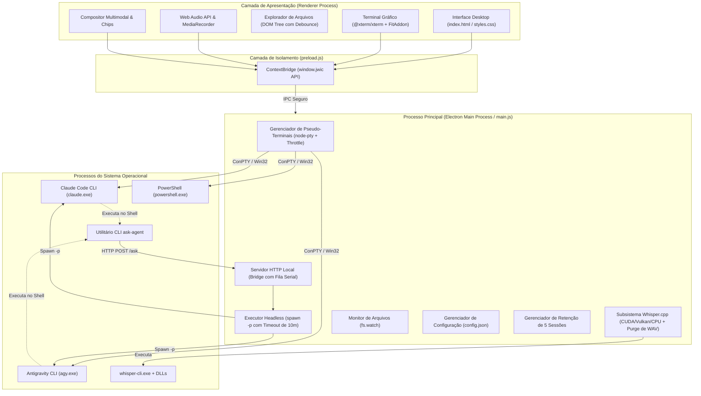

# Arquitetura Técnica do CommandDeck Terminal

Este documento especifica em nível detalhado a arquitetura de software, componentes internos, fluxos de dados, modelos de concorrência e comunicações interprocessos (IPC) do **CommandDeck Terminal**.

---

## 🏛️ Visão Geral da Arquitetura

O **CommandDeck Terminal** é uma aplicação desktop desenvolvida sobre o framework **Electron**, concebida para atuar como uma camada de orquestração unificada para ferramentas de linha de comando (CLIs) de inteligência artificial generativa — notadamente o **Claude Code** (`claude`) e o **Antigravity CLI** (`agy`).

---

## 🧩 Componentes do Processo Principal (`main.js`)

O processo principal do Electron é o núcleo da aplicação, responsável pelo gerenciamento de janelas, ciclo de vida de processos do sistema operacional e segurança.

### 1. Resolução e Ciclo de Vida dos Pseudo-Terminais (`node-pty`)
- **Detecção de Binários:** O CommandDeck verifica os diretórios canônicos dos CLIs (`%APPDATA%\npm`, `%LOCALAPPDATA%\agy\bin`, etc.) e recorre ao utilitário `where.exe` do Windows. Caso o binário do Claude ou Antigravity não seja encontrado, retorna `null` e orienta a instalação via mensagem informativa.
- **Instanciação com ConPTY e Throttle:** Terminais interativos utilizam a API nativa do Windows Pseudo Console (`useConpty: true`). O evento `pty:resize` aplica um throttle de 60ms para impedir rajadas de redimensionamento que causam deadlocks no ConPTY.
- **Injeção de Ambiente (`agentEnv`):** Para cada sessão de terminal iniciada, o ambiente do processo é customizado com:
  - Adição do diretório `bin/` ao `PATH`;
  - Remoção de variáveis que indicam subprocessos aninhados (`CLAUDECODE`, `ELECTRON_RUN_AS_NODE`);
  - Injeção das variáveis de controle da ponte: `JWIC_PORT`, `JWIC_TOKEN`, `JWIC_AGENT`, `JWIC_DEPTH` e `JWIC_NODE`.
- **Canal de Submissão (`pty:submit`):** Para envio de texto sem corrupção de quebras de linha acidentais, a submissão utiliza envelopamento em *Bracketed Paste Mode* (`\x1b[200~` e `\x1b[201~`) seguido de `\r` (com confirmação dupla esperada ao citar referências `@`).

### 2. Ponte HTTP Local com Fila Serial por Agente
- **Servidor Efêmero:** O servidor HTTP é instanciado em `127.0.0.1` na porta TCP `0` (alocação dinâmica).
- **Validação de Host:** O cabeçalho `Host` é rigorosamente validado contra `127.0.0.1:${port}` e `localhost:${port}`, mitigando ataques de DNS Rebinding.
- **Autenticação Criptográfica:** Um token aleatório de 128 bits (`BRIDGE_TOKEN`) é gerado por sessão e exigido no cabeçalho `x-jwic-token`.
- **Fila de Exclusão Mútua (`bridgeQueues`):** Requisições simultâneas destinadas ao mesmo par de agentes são serializadas por meio de uma cadeia de Promises, eliminando condições de corrida (race conditions) e prevenindo corrupção do histórico de sessão.

### 3. Executor Headless (`runHeadless`)
Quando um agente consulta outro via `ask-agent` ou durante mesas colaborativas:
- **Claude Code:** Invocado com `-p --output-format text`, com suporte a `--session-id` e `--resume`. Possui **timeout explícito de 10 minutos** no processo Node.js para garantir que chamadas travadas sejam encerradas graciosamente.
- **Antigravity CLI:** Invocado com `-p "<prompt>" --output-format json --print-timeout 10m` e `--conversation`.
- **Tratamento de Mensagens Longas:** Prompts que excedem 24.000 caracteres são gravados em arquivo na pasta `dados/prompts/` (com identificador de sessão) e referenciados no comando.

### 4. Gestão de Workspace e Política de Arquivos
- **Workspace Padrão Isolado:** Por padrão, os agentes operam na pasta `workspace/` interna ao diretório da aplicação, impedindo a criação de arquivos fora da pasta do projeto.
- **Proteção do Diretório Home:** O CommandDeck **nunca cria arquivos `AGENTS.md` na raiz da pasta do usuário (`os.homedir()`)** nem em diretórios de sistema. A injeção de contexto ocorre apenas na pasta de trabalho isolada ou em repositórios onde o arquivo `AGENTS.md` já exista previamente.
- **Retenção de até 5 Sessões:** Áudios `.wav` são excluídos imediatamente após a transcrição. Prompts e anexos/capturas são retidos para as últimas 5 sessões ativas; resíduos de sessões anteriores são limpos automaticamente na inicialização.

---

## 🔒 Camada de Segurança e Isolamento (`preload.js`)

1. **Context Isolation (`contextIsolation: true`):** O renderizador executa isolado do runtime do Node.js.
2. **Node Integration Desabilitado (`nodeIntegration: false`):** Scripts da UI não acessam módulos de baixo nível do sistema operacional.
3. **API Controlada (`contextBridge.exposeInMainWorld`):** Somente métodos estritamente necessários e sanitizados são expostos no objeto `window.jwic`.
4. **Cópia Assíncrona de Anexos:** A adição de arquivos ao compositor opera através de I/O assíncrono em worker pool (`fs.promises.copyFile`), eliminando qualquer travamento no thread principal de renderização.

---

## 🖥️ Camada de Apresentação (Renderer Process)

### 1. Terminal Gráfico com xterm.js
- Instâncias do `Terminal` são criadas dinamicamente para cada aba aberta com `@xterm/addon-fit`.
- Abas inativas são mantidas com `visibility: hidden`, preservando o buffer de rolagem (10.000 linhas) sem custo excessivo de CPU/GPU.

### 2. Conversão e Captura de Áudio (Web Audio API)
- A captura de microfone via `MediaRecorder` converte o áudio para 16 kHz mono através de `OfflineAudioContext`.
- Um botão integrado de cancelamento permite abortar a fala a qualquer instante, liberando o dispositivo sem acionar o motor de inferência nem salvar dados em disco.

### 3. Explorador de Arquivos com Debounce
- A árvore de arquivos implementa debounce de 220ms no manipulador de clique simples. Um clique rápido duplo aciona exclusivamente a abertura nativa no sistema operacional (`api.openPath`), prevenindo a inserção acidental de tokens duplicados no campo do compositor.
