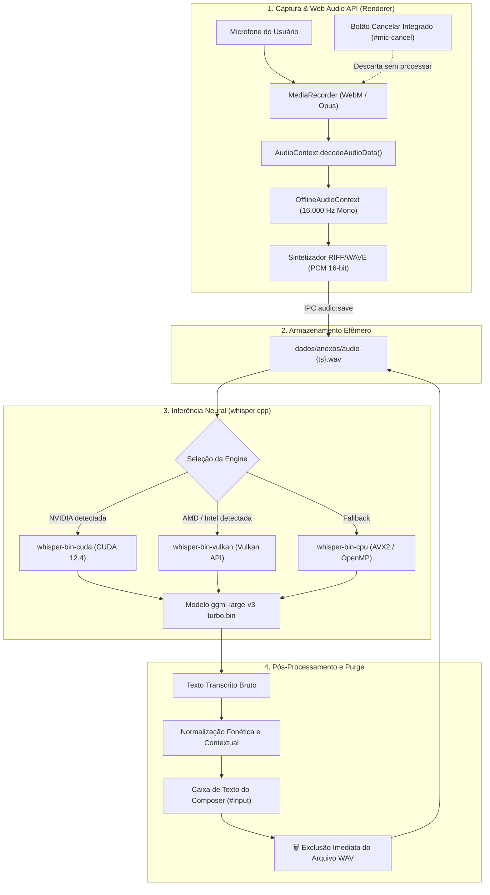

# Subsistema de Transcrição de Voz Local (Whisper.cpp)

Este documento descreve detalhadamente a engenharia de áudio, detecção de hardware, inferência neural, ciclo de descarte de dados e técnicas de pós-processamento de linguagem natural do subsistema de transcrição de voz do **CommandDeck Terminal**.

---

## 🎙️ Arquitetura, Privacidade e Descarte Imediato

O subsistema de áudio do CommandDeck opera sob o princípio de **privacidade total, execução 100% local e retenção zero de arquivos de áudio**:
- Nenhum pacote de áudio é enviado para servidores externos.
- Todo o processamento ocorre no hardware local (GPU ou CPU) via **`whisper.cpp`** com o modelo **`large-v3-turbo`** (~1,6 GB).
- **Descarte Imediato:** Assim que o áudio é transcrito para texto e inserido no campo do compositor, o arquivo `.wav` correspondente é **imediatamente excluído do disco** (`fs.promises.unlink`). Não há retenção residual de gravações de voz.



---

## ❌ Botão Integrado de Cancelamento de Áudio

Ao iniciar a captura pelo botão de microfone (`#mic`), a interface exibe imediatamente um botão integrado de cancelamento (`#mic-cancel` com ícone `×` vermelho suave):
- **Ação:** Se o usuário falar algo incorreto ou desistir da gravação, um clique no botão de cancelamento aborta o fluxo instantaneamente.
- **Efeito:** As faixas de captura são interrompidas e os buffers de áudio são destruídos em memória sem gerar arquivos temporários no disco e sem acionar o motor de inferência Whisper.

---

## ⚙️ Pipeline de Áudio: Conversão para WAV PCM 16kHz

O modelo Whisper exige áudio estritamente no formato PCM linear de 16-bit com taxa de amostragem de 16 kHz em canal mono. 

O CommandDeck realiza toda a conversão de áudio nativamente dentro do navegador via Web Audio API, sem depender de utilitários externos como FFmpeg:

1. **Captura:** O fluxo de entrada do microfone é capturado via `navigator.mediaDevices.getUserMedia({ audio: true })`.
2. **Decodificação:** Os chunks WebM/Opus gerados pelo `MediaRecorder` são decodificados para um buffer de áudio na taxa nativa do dispositivo.
3. **Reamostragem (`OfflineAudioContext`):**
   ```javascript
   const rate = 16000;
   const off = new OfflineAudioContext(1, Math.ceil(audio.duration * rate), rate);
   const src = off.createBufferSource();
   src.buffer = audio;
   src.connect(off.destination);
   src.start();
   const pcm = (await off.startRendering()).getChannelData(0);
   ```
4. **Geração do Cabeçalho RIFF de 44 bytes:** Uma estrutura binária `DataView` aloca o cabeçalho WAV padrão:
   - ChunkID `"RIFF"`, Formato `"WAVE"`;
   - Subchunk1ID `"fmt "`, Formato de áudio `1` (PCM linear);
   - Número de canais `1` (Mono);
   - Taxa de amostragem `16000` Hz;
   - Taxa de bytes `32000` bytes/s (`16000 * 1 * 16 / 8`);
   - Alinhamento de bloco `2` bytes;
   - Bits por amostra `16`;
   - Subchunk2ID `"data"`.
5. **Conversão Float32 para Int16:** Os valores normalizados de `[-1.0, 1.0]` são quantizados para inteiros com sinal de 16 bits no intervalo de `[-32768, 32767]`.

---

## ⚡ Detecção e Aceleração por Hardware

O CommandDeck inspeciona os controladores de vídeo ativos no sistema operacional através do PowerShell WMI:

```powershell
(Get-CimInstance Win32_VideoController).Name
```

Com base no fabricante da GPU, a melhor engine disponível é priorizada:

| Engine | Hardware Alvo | Binários e DLLs | Fonte de Obtenção |
| :--- | :--- | :--- | :--- |
| **CUDA** | Placas NVIDIA GeForce / RTX / Quadro | `whisper-bin-win-cuda-12.4.0-x64.zip` | Download automático oficial (GitHub Releases) |
| **Vulkan** | Placas AMD Radeon, Intel Arc / Iris Xe | `whisper/bin-vulkan/` (`ggml-vulkan.dll`) | Compilação local via CMake a partir de `whisper/src` |
| **CPU** | Todos os processadores x86_64 (AVX2 / FMA) | `whisper-bin-x64.zip` | Download automático oficial (GitHub Releases) |

### Mecanismo de Fallback em Cascata
Se a execução na GPU NVIDIA ou Vulkan falhar por erro de driver, falta de VRAM ou crash de DLL, o CommandDeck registra o aviso no painel de conversa integrada e tenta automaticamente a próxima engine da fila (GPU seguinte ou CPU), garantindo que a fala do usuário não seja perdida.

---

## 🎛️ Parâmetros de Linha de Comando do `whisper-cli.exe`

Ao processar um arquivo de áudio, o processo principal executa o executável nativo com as seguintes flags:

| Flag | Argumento | Finalidade |
| :--- | :--- | :--- |
| `-m` | `whisper/models/ggml-large-v3-turbo.bin` | Caminho absoluto para os pesos do modelo neural. |
| `-f` | `<caminho-do-arquivo.wav>` | Arquivo de áudio de entrada gravado na sessão. |
| `-l` | `pt` (ou `auto`) | Idioma forçado para português do Brasil ou detecção automática. |
| `-nt` | *(sem valor)* | Remove os timestamps (marcações de tempo) da transcrição. |
| `-np` | *(sem valor)* | Oculta mensagens de progresso no stdout, mantendo a saída limpa. |
| `-t` | `Math.max(1, cpus - 2)` | Alocação dinâmica de threads de processamento para não sobrecarregar a CPU. |
| `--prompt` | `WHISPER_PROMPT` | Injeção de vocabulário técnico contextual (veja seção abaixo). |
| `-mc` | `0` | Limita o contexto de tokens anteriores a zero, evitando loops em que o modelo repete a mesma frase indefinidamente. |
| `--carry-initial-prompt` | *(sem valor)* | Garante que o vocabulário injetado seja preservado em todos os segmentos da gravação. |
| `-ng` | *(sem valor)* | *(Apenas na engine CPU)* Desabilita chamadas a drivers gráficos. |

---

## 🎯 Vocabulário Contextual e Normalização Fonética

O CommandDeck emprega um vocabulário contextual aprimorado e regras de normalização que preservam termos em inglês como "Google Cloud" e "Cloud computing", atuando estritamente em contextos de comando:

### 1. Injeção de Prompt Contextual (`--prompt`)
```javascript
const WHISPER_PROMPT = 'CommandDeck Terminal, Claude, Antigravity, agy, Claude Code, terminal, CLI, assistente Claude, Google Antigravity, Vulkan, NVIDIA, AMD.';
```

### 2. Normalização Fonética Contextual
Substituições inteligentes que protegem substantivos técnicos da computação em nuvem:

| Padrão Identificado | Normalização Aplicada |
| :--- | :--- |
| *Cloud Code*, *Cloud CLI*, *Cloud agente* | `Claude Code`, `Claude CLI`, `Claude agente` |
| *com o Cloud*, *para o Cloud*, *pergunta pro Cloud* | `com o Claude`, `para o Claude`, `pergunta pro Claude` |
| *Anticrafty*, *Anticraft*, *Antigraft*, *Anti-gravity* | `Antigravity` |
| *Google Cloud*, *Cloud computing* | **Preservado como Cloud** |
| `[BLANK_AUDIO]` (ruído sem fala) | Removido / Espaço em branco |
